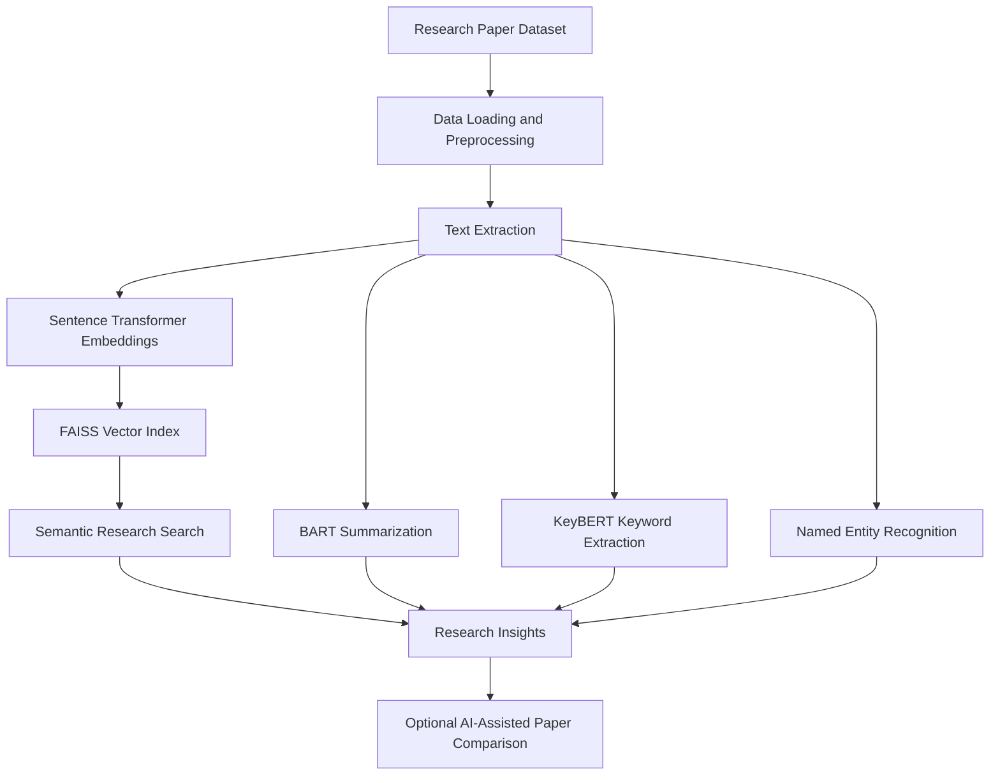

# 🧠 Research Paper Intelligence System

### An AI-Powered Platform for Intelligent Research Discovery, Semantic Search & Automated Paper Analysis

<p align="center">

  **Discover. Understand. Analyze. Accelerate Research.**

</p>

---

## 📌 Overview

The **Research Paper Intelligence System** is an AI-powered research assistant designed to simplify the process of discovering, understanding, and analyzing scientific research papers.

Traditional literature reviews often require researchers to manually explore large collections of academic papers, read lengthy abstracts, identify relevant keywords, and compare findings across multiple publications. This project leverages modern Natural Language Processing (NLP), semantic search, and transformer-based models to make research exploration faster, more intelligent, and more efficient.

The system integrates multiple AI capabilities into a unified workflow, enabling users to search for relevant research, generate concise summaries, extract important keywords, identify named entities, and explore relationships between scientific publications.

## ✨ Key Features

| Feature | Description |
|---|---|
| 🔎 **Semantic Research Search** | Discover relevant research papers using vector embeddings and FAISS similarity search. |
| 📝 **AI-Powered Summarization** | Generate concise summaries of research abstracts using transformer-based summarization. |
| 🔑 **Keyword Extraction** | Identify important concepts and research terms using KeyBERT. |
| 🧩 **Named Entity Recognition** | Extract relevant entities and technical concepts from research text. |
| ⚖️ **Paper Comparison** | Support AI-assisted comparison of research papers using Groq-powered capabilities, when configured. |
| 🤖 **AI Tool Integration** | Integrate language-model-based tools and workflows using LangChain. |
| 📚 **Dataset Processing** | Load and preprocess research-paper data for downstream analysis. |
| 🧠 **Semantic Embeddings** | Convert textual research content into numerical representations for meaning-based retrieval. |

## 🛠️ Technology Stack

**Programming Language**
- Python

**Artificial Intelligence & NLP**
- Hugging Face Transformers
- Sentence Transformers
- BART summarization model
- KeyBERT
- Named Entity Recognition (NER)

**Search & Retrieval**
- FAISS
- Vector embeddings
- Semantic similarity search

**AI Integration**
- LangChain
- Groq API (optional, for supported LLM workflows)

**Data & Development**
- Hugging Face Datasets
- Pandas
- NumPy
- Jupyter Notebook / Google Colab

## 🏗️ System Architecture

The system follows a modular research-processing pipeline.



### How It Works

1. **Data ingestion:** Load the research-paper dataset and prepare the available textual information.
2. **Preprocessing:** Clean and organize the text for analysis.
3. **Embedding generation:** Encode research content into semantic vector representations using Sentence Transformers.
4. **Indexing:** Use FAISS to enable efficient similarity-based retrieval.
5. **Research discovery:** Retrieve papers based on semantic relevance rather than relying exclusively on exact keyword matches.
6. **Text analysis:** Generate summaries, extract keywords, and identify named entities.
7. **AI-assisted analysis:** Use optional LLM integrations to support paper comparison and related research workflows.

## 🚀 Getting Started

### Option 1: Run in Google Colab

Google Colab provides a convenient environment for running the project without configuring a local Python environment.

1. Open [Google Colab](https://colab.research.google.com/).
2. Upload the project's `.ipynb` notebook.
3. Run the setup and dependency-installation cells.
4. Execute the notebook cells in order.
5. Load the research dataset when prompted or as configured in the notebook.
6. Configure optional API credentials if you intend to use Groq-powered features.
7. Run the search, summarization, keyword extraction, and analysis workflows.

**Note:** Model downloads and embedding generation may take time on the first run. Enable a GPU runtime when appropriate for supported workloads.

### Option 2: Run Locally

#### 1. Clone the repository

```bash
git clone https://github.com/YOUR-USERNAME/research-paper-intelligence-system.git
cd research-paper-intelligence-system
```

Replace `YOUR-USERNAME` with your GitHub username and update the repository URL if your repository has a different name.

#### 2. Create a virtual environment

```bash
python -m venv .venv
```

Activate it on Windows:

```powershell
.venv\Scripts\Activate.ps1
```

On macOS or Linux:

```bash
source .venv/bin/activate
```

#### 3. Install dependencies

Install the packages required by the project:

```bash
pip install pandas numpy datasets sentence-transformers faiss-cpu transformers keybert langchain
```

Install any additional packages required by the notebook or Python script. Package versions and optional integrations should be aligned with the project's actual imports.

#### 4. Launch the project

For a Jupyter notebook:

```bash
pip install notebook
jupyter notebook
```

Open the project notebook and execute its cells in sequence.

For the Python script:

```bash
python coding_blocks_research_paper_intelligence_system.py
```

Use the notebook workflow if the script relies on notebook-specific features or has not yet been adapted for standalone execution.

## 🔐 API Configuration

Some advanced workflows may use the Groq API for language-model-powered analysis.

1. Obtain an API key from the [Groq Console](https://console.groq.com/).
2. Store the key securely in an environment variable or your notebook's secret manager.
3. Read the key from the environment in your Python code.

Example:

```python
import os

GROQ_API_KEY = os.getenv("GROQ_API_KEY")

if not GROQ_API_KEY:
    raise ValueError("Please configure the GROQ_API_KEY environment variable.")
```

**Security:** Never commit API keys, passwords, or other secrets to GitHub. Use environment variables or a secure secrets manager instead.

## 📊 Applications

The system can support several research and academic workflows:

- **Literature reviews:** Find potentially relevant papers across a research collection.
- **Academic research:** Explore scientific topics through semantic retrieval.
- **Research summarization:** Reduce the time spent reviewing lengthy abstracts.
- **Knowledge discovery:** Identify important terminology and entities.
- **Comparative analysis:** Support the exploration of similarities and differences between publications.
- **Research assistance:** Build a foundation for more advanced AI-powered research tools.

## 🎯 Project Objectives

- Apply transformer-based NLP techniques to academic text.
- Implement semantic search using sentence embeddings and vector indexing.
- Automate key parts of research-paper analysis.
- Combine multiple NLP capabilities into a unified pipeline.
- Explore practical integrations between retrieval systems and large language models.

## 🔮 Future Enhancements

Potential extensions include:

- [ ] PDF upload and automatic paper ingestion.
- [ ] Full-text PDF parsing and section-aware analysis.
- [ ] Conversational question answering over research papers using Retrieval-Augmented Generation (RAG).
- [ ] Citation extraction and reference-network analysis.
- [ ] Side-by-side comparison of methodologies, datasets, and results.
- [ ] A Streamlit web interface for interactive research exploration.
- [ ] Persistent vector storage and incremental indexing.
- [ ] Exportable summaries and structured research reports.
- [ ] Evaluation of retrieval relevance and summarization quality.

## ⚠️ Limitations

- Search quality depends on the dataset, embedding model, and indexing configuration.
- Summaries may omit important details and should be checked against the original paper.
- Named entity extraction and keyword extraction may not capture every domain-specific concept.
- LLM-generated comparisons can contain inaccuracies and require verification.
- Availability and performance of optional features depend on their model and API configuration.

## 📁 Project Structure

The repository may be organized as follows, depending on the files included in the final version:

```text
research-paper-intelligence-system/
│
├── coding_blocks_research_paper_intelligence_system.py
├── research_paper_intelligence_system.ipynb
├── requirements.txt
├── README.md
├── .gitignore
│
└── data/
    └── research_papers.csv
```

*The structure above is illustrative. Keep only the files and folders that actually exist in your repository.*

## 🧪 Reproducibility

For reproducible experiments:

- Record Python and package versions.
- Document the dataset source and preprocessing steps.
- Specify the embedding and summarization models used.
- Keep API credentials outside the repository.
- Document any hardware or runtime requirements.
- Evaluate retrieval and generated outputs against appropriate reference examples.

## 🤝 Contributing

Contributions and suggestions are welcome.

1. Fork the repository.
2. Create a feature branch.
3. Implement and test your changes.
4. Submit a pull request with a clear explanation of the improvements.

## 📄 License

Choose an appropriate open-source license before publishing this project. If you select the MIT License, include the corresponding `LICENSE` file in the repository.

## 👨‍💻 Author

**Manav**

AI / Machine Learning | Natural Language Processing | Data Science

GitHub: manavstack-ship-it

---

<p align="center">

  **Built to make research discovery smarter, faster, and more accessible.**

</p>
